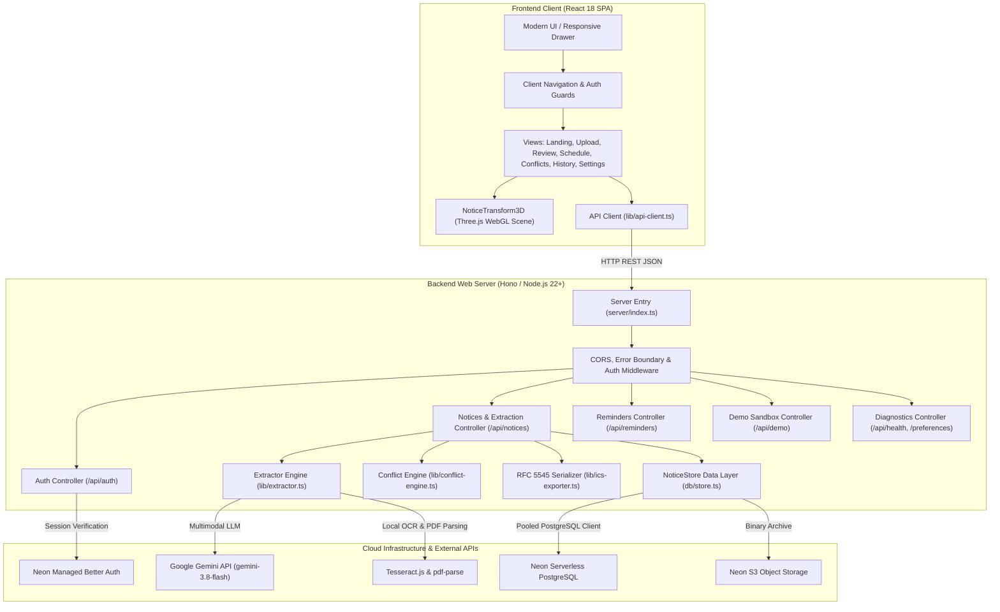

# Notice Decoder

> **Turn Any Document into a Clear, Conflict-Free Schedule & Action Plan.**  
> An enterprise-grade, general-purpose Document-to-Action platform powered by multimodal AI, deterministic conflict arithmetic, and cloud persistence.

---

## 1. Product Overview

In everyday operations across education, business, government, conferences, and personal life, critical schedules and directives arrive trapped inside unstructured documents—PDF announcements, circulars, meeting minutes, executive memos, and scanned images. Manually parsing these documents leads to missed deadlines, scheduling overlaps, and operational confusion.

**Notice Decoder** bridges the gap between unstructured prose and calendar applications. It combines:
- **Universal Intake & OCR**: Ingests text-layer PDFs, scanned documents, and images (PDF, PNG, JPG, JPEG) up to 10 MB, plus direct text paste.
- **Multimodal AI Classification**: Powered by Google Gemini (`gemini-3.8-flash` with graceful fallback) to extract structured events, discrete deadlines, action items, directives, and contact points across academic, corporate, government, legal, and medical domains.
- **Fact-Preserving Multilingual Summaries**: Generates executive summaries in **English**, **Hinglish** (Roman script Hindi-English), and **Hindi** (Devanagari script) with cached PostgreSQL storage.
- **Deterministic Conflict Engine**: Mathematically calculates interval clashes without model hallucination using half-open interval overlap arithmetic ($A.\text{start} < B.\text{end} \land B.\text{start} < A.\text{end}$).
- **Human-in-the-Loop Review Gate**: Inspect proposed events side-by-side with original document evidence before committing to schedules.
- **Manual Reminders CRUD**: Create, edit, toggle, and delete personal reminders with or without an attached document.
- **Universal Calendar Export**: One-click RFC 5545 `.ics` export compatible with Google Calendar, Apple Calendar, and Microsoft Outlook.
- **Cloud Persistence & Strict Isolation**: Secure user accounts backed by Neon Serverless PostgreSQL with parameter-bound queries and cascading account deletion.
- **Isolated Evaluation Sandbox**: Interactive 4-scenario demo environment accessible to all visitors without mutating production user records.

---

## 2. Architecture & Technology Stack



### Stack Components
- **Frontend**: React 18, TypeScript (strict), Vite 6, Tailwind CSS, Framer Motion, Lucide Icons, Three.js.
- **Backend**: Node.js (v22/v24), Hono REST API framework, `@hono/node-server`.
- **Database & Storage**: Neon Serverless PostgreSQL (`@neondatabase/serverless`), Neon S3-compatible Object Storage (`@aws-sdk/client-s3`).
- **Authentication**: Neon Auth (Managed Better Auth) + server-side cryptographic `scrypt` hashing and session verification.
- **AI & OCR**: `@google/genai` (Google Gemini API), `tesseract.js` (OCR), `pdf-parse` (PDF text extraction).
- **Testing**: Vitest (`vitest run`).
- **Deployment**: Render Web Service (`render.yaml`).

---

## 3. Repository Structure

```text
Notice_Decoder/
├── .github/
│   └── workflows/
│       └── ci.yml             # Automated GitHub Actions CI (Typecheck, Test, Build)
├── docs/                      # Dedicated Architectural & Client Documentation
│   ├── architecture.md        # In-depth system architecture & data flow
│   ├── setup.md               # Local development setup & commands
│   ├── api.md                 # Complete REST API endpoint reference
│   ├── security.md            # Security controls & threat model
│   └── deployment.md          # Production deployment guide for Render & Neon
├── server/                    # Modular Backend Server
│   ├── config/
│   │   └── env.ts             # Centralized environment variable validation
│   ├── middleware/
│   │   └── auth.ts            # Authentication guards & session resolution
│   ├── routes/
│   │   ├── auth.routes.ts     # User sign-up, sign-in, session, account wipe
│   │   ├── demo.routes.ts     # 4 isolated sandbox demo scenarios
│   │   ├── diagnostics.routes.ts # Health check, Neon probes, user preferences
│   │   ├── notices.routes.ts  # Upload, OCR, review, multilingual, .ics export
│   │   └── reminders.routes.ts# Personal reminder CRUD endpoints
│   └── index.ts               # Server entry point & static SPA routing
├── src/                       # Frontend Application
│   ├── components/            # Reusable UI components & modals
│   │   ├── AddReminderModal.tsx  # Manual reminder creation modal
│   │   ├── AuthModal.tsx         # Universal account modal & password strength
│   │   ├── DemoSandboxModal.tsx  # Interactive 4-scenario evaluation modal
│   │   ├── Footer.tsx            # Application footer
│   │   ├── Navbar.tsx            # Responsive desktop navbar & mobile drawer
│   │   └── NoticeTransform3D.tsx # WebGL notice transformation scene
│   ├── db/                    # Database migrations & repository
│   │   ├── connection.ts      # Neon connection pooling & telemetry
│   │   ├── migrate.ts         # Automated schema migration runner
│   │   ├── schema.sql         # PostgreSQL schema definition
│   │   ├── seed.ts            # Demo seed script
│   │   └── store.ts           # Parameterized SQL repository layer
│   ├── lib/                   # Shared business logic & services
│   │   ├── ai-config.ts       # Centralized Gemini model configuration
│   │   ├── api-client.ts      # Frontend HTTP client & cookie handlers
│   │   ├── auth-server.ts     # Server authentication & session verification
│   │   ├── conflict-engine.ts # Half-open interval conflict arithmetic
│   │   ├── extractor.ts       # AI extraction, taxonomy & multilingual translator
│   │   ├── ics-exporter.ts    # RFC 5545 iCalendar serializer
│   │   └── neon-services.ts   # Neon Object Storage & function clients
│   ├── types/                 # Strict TypeScript domain types & schemas
│   ├── views/                 # Primary routed views
│   │   ├── ConflictsView.tsx  # Deterministic overlap cards & math proofs
│   │   ├── DashboardView.tsx  # Scheduling metrics & upcoming commitments
│   │   ├── HistoryView.tsx    # Document repository & deletion
│   │   ├── LandingView.tsx    # Editorial landing page & demo launcher
│   │   ├── ReviewView.tsx     # Evidence review gate & 3-language summaries
│   │   ├── ScheduleView.tsx   # Chronological schedule & reminder list
│   │   ├── SettingsView.tsx   # User profile, languages, timezone, deletion
│   │   └── UploadView.tsx     # File drag-and-drop & text ingestion
│   ├── App.tsx                # Master app routing & navigation guards
│   ├── index.css              # Global styles & zero-overflow constraints
│   └── main.tsx               # Client entry point
├── tests/                     # Automated Vitest Test Suite (67 tests)
│   ├── api-client.test.ts     # Client request & header handling
│   ├── api.test.ts            # Hono REST API & multi-user isolation suite
│   ├── conflict-engine.test.ts# Deterministic interval math unit tests
│   ├── extractor.test.ts      # Heuristic fallback & translation tests
│   └── ics-exporter.test.ts   # RFC 5545 calendar compliance tests
├── .editorconfig              # Consistent multi-editor formatting
├── .env.example               # Safe environment variable template
├── .gitignore                 # Protected build & secret exclusion rules
├── package.json               # Scripts & dependencies
├── render.yaml                # Render Infrastructure-as-Code Blueprint
├── tsconfig.json              # Strict TypeScript compiler options
└── vite.config.ts             # Vite bundler & reverse proxy config
```

---

## 4. Quick Start (Local Development)

### 4.1 Prerequisites
- **Node.js**: v20+, v22+, or v24+ (`node -v`)
- **npm**: v10+ (`npm -v`)
- **Git**: (`git --version`)

### 4.2 Installation
```bash
git clone https://github.com/Algorithm-Artist-ctrl/Notice_Decoder.git
cd Notice_Decoder
npm install
```

### 4.3 Environment Setup
Copy the sample configuration file and populate your credentials:
```bash
cp .env.example .env
```

Key environment variables:
| Variable | Description | Default / Example |
|---|---|---|
| `DATABASE_URL` | Neon PostgreSQL pooled connection string | `postgresql://...@ep-...neon.tech/neondb?sslmode=require` |
| `GEMINI_API_KEY` | Google AI Studio API Key for multimodal extraction | `AIzaSy...` |
| `GEMINI_MODEL` | Active Gemini model ID | `gemini-3.8-flash` |
| `PORT` | Local server port | `3000` |
| `DEFAULT_TIMEZONE` | Timezone for date parsing and `.ics` generation | `Asia/Kolkata` |
| `CLIENT_URL` | Client URL for CORS and Better Auth origin | `http://localhost:5173` |

### 4.4 Run Development Servers
```bash
# Concurrently runs Vite client (5173) and Hono server (3000)
npm run dev
```
Open [http://localhost:5173](http://localhost:5173) in your browser.

---

## 5. Testing, Typecheck & Quality Assurance

Notice Decoder includes an exhaustive automated test suite with **67 passed tests (100%)** across 5 test files:

```bash
# Execute Vitest automated test suite
npm test

# Run TypeScript compiler strict type check
npm run typecheck

# Run linter
npm run lint

# Build production bundle
npm run build
```

---

## 6. Production Deployment (Render)

Notice Decoder is configured for seamless deployment on Render:

1. Connect your GitHub repository to [Render Dashboard](https://dashboard.render.com).
2. Create a new **Web Service** or use the included [`render.yaml`](file:///Users/tarun/Documents/Notice_Decoder/render.yaml) blueprint:
   - **Build Command**: `npm install --include=dev && npm run build`
   - **Start Command**: `npm start`
3. Set your environment variables in the Render dashboard:
   - `DATABASE_URL`: Your pooled Neon connection string.
   - `GEMINI_API_KEY`: Your Google AI Studio API key.
   - `NODE_ENV`: `production`
   - `DEFAULT_TIMEZONE`: `Asia/Kolkata`
4. Deploy the service. Migrations run automatically on startup.

---

## 7. Known Limitations & Service Boundaries

1. **Air-Gapped / Keyless Environments**: If `GEMINI_API_KEY` is not provided, Notice Decoder automatically falls back to its deterministic heuristic NLP engine. While accurate on structured circulars, complex scanned multi-column tables benefit from multimodal LLM vision.
2. **Scanned Images Quality**: Low-resolution camera photos of physical boards or blurred scans may require manual correction in the human-in-the-loop review gate.
3. **Point Deadlines vs Timed Events**: Deadlines without explicit start/end times are correctly treated as instantaneous point deadlines to prevent false schedule overlap warnings.

---

## 8. License

This project is licensed under the MIT License. See [LICENSE](file:///Users/tarun/Documents/Notice_Decoder/LICENSE) for details.
