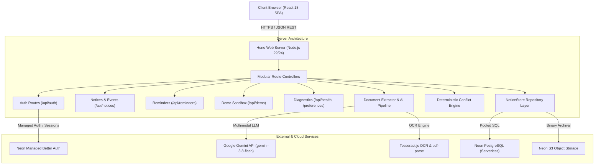

# Notice Decoder — Architecture Specification

## 1. System Overview

Notice Decoder is a high-reliability Document-to-Action platform engineered to ingest unstructured notices, memos, circulars, meeting minutes, and advisories, and transform them into structured, verifiable schedules, personal reminders, and action plans.

---

## 2. Layered Component Architecture

### 2.1 Frontend Presentation Layer (`src/`)
- **Framework**: React 18 with TypeScript in strict mode, bundled via Vite 6.
- **Styling**: Tailwind CSS with explicit overflow bounding (`body { overflow-x: clip; }`, `min-width: 0`).
- **State Management**: React state with unidirectional data flow and localized custom storage bindings.
- **Views**:
  - `LandingView`: Public hero, interactive 3D paper transformation scene (`NoticeTransform3D`), value proposition, capabilities, and demo launcher.
  - `UploadView`: Drag-and-drop file ingestion (PDF, PNG, JPG, JPEG) with client-side 10 MB validation and direct text paste.
  - `ReviewView`: Side-by-side human-in-the-loop review gate, original document evidence inspection, live recalculated conflict warnings, and 3-language summary switcher.
  - `DashboardView`: Key scheduling metrics, personal reminders, and combined upcoming commitments list.
  - `ScheduleView`: Chronological agenda view, reminder status toggling, and category filters.
  - `ConflictsView`: Visual timeline of schedule overlaps and point deadline collisions with mathematical proof output.
  - `HistoryView`: Chronological document repository with status badges and deletion triggers.
  - `SettingsView`: User profile, language preference, timezone selection, reminder lead times, `.ics` calendar export, and permanent account deletion.

### 2.2 Backend Application Layer (`server/`)
- **Runtime**: Node.js executed via `tsx` TypeScript runtime.
- **HTTP Framework**: Hono (`hono` + `@hono/node-server`), delivering sub-millisecond route dispatching and minimal memory overhead.
- **Modular Directory Structure**:
  - `server/index.ts`: Application bootstrap, CORS middleware, global error boundary, static SPA delivery, and server listener.
  - `server/config/env.ts`: Centralized environment variable validation and runtime defaults.
  - `server/middleware/auth.ts`: Session resolution, authorization guards, and guest session isolation.
  - `server/routes/auth.routes.ts`: Account registration, sign-in, session checks, logout, and cascading account deletion.
  - `server/routes/notices.routes.ts`: Document upload, OCR/text extraction, notice lifecycle, multilingual translation, and `.ics` export.
  - `server/routes/reminders.routes.ts`: Personal reminder CRUD with ownership checks.
  - `server/routes/demo.routes.ts`: Memory-isolated demonstration scenarios and seed datasets.
  - `server/routes/diagnostics.routes.ts`: Health telemetry, Neon service probes, and user preference persistence.

### 2.3 Data Access & Persistence Layer (`src/db/`)
- **Database Engine**: Neon Serverless PostgreSQL with pooled connection management.
- **Driver**: `@neondatabase/serverless` using WebSocket/HTTP query execution.
- **Data Repository (`src/db/store.ts`)**: Parameterized SQL queries preventing SQL injection, mapping snake_case database columns to camelCase TypeScript domain models.
- **Migrations (`src/db/migrate.ts`)**: Idempotent DDL migration script executed automatically at server boot.

---

## 3. Core Processing Pipelines

### 3.1 Document Ingestion & Extraction Pipeline
1. **Magic Byte Validation**: Uploaded buffers are verified against binary signatures (`%PDF` for PDF, `\x89PNG` for PNG, `\xFF\xD8\xFF` for JPEG).
2. **Text Acquisition**:
   - Native PDFs: Direct text-layer extraction via `pdf-parse`.
   - Scanned PDFs or Images: OCR text recognition via `tesseract.js` worker threads.
3. **Classification & Extraction**:
   - Active LLM: Google Gemini API (`gemini-3.8-flash`, with `gemini-2.0-flash` fallback).
   - Fallback Engine: Deterministic rule-based regex parser for air-gapped or keyless environments.
   - Classification Schema: Categorizes into Cases A through F (Timed Schedule, Deadlines, Directives, Zero-Date Information, Mixed, Corrupted).
4. **Multilingual Synthesis**:
   - Document executive summary generated in English, Hinglish (Roman script Hindi-English), and Hindi (Devanagari script).
   - Strict preservation of numerical, temporal, and proper entity data across all translations.

### 3.2 Deterministic Conflict Detection Engine
The schedule conflict engine operates deterministically on ISO date strings and half-open time intervals $[S, E)$:

$$\text{Conflict}(A, B) \iff A.\text{start} < B.\text{end} \land B.\text{start} < A.\text{end}$$

- **Hard Overlaps**: Two timed events whose intervals intersect for $\ge 1$ minute. The intersection window is calculated explicitly:
  $$[\max(A.\text{start}, B.\text{start}), \min(A.\text{end}, B.\text{end}))$$
- **Deadline Warnings**: Point deadlines that fall within the active duration of another event trigger a separate, non-overlapping `DEADLINE_DURING_EVENT` alert.
